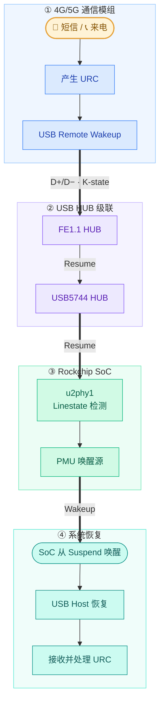

---
tags:
  - LTE
---

## USB 基础

- USB 正常数据事务由 Host 调度；Device 可根据 Token 返回 DATA/NAK，也能产生连接状态及受协议约束的远程唤醒电气事件
- Remote wakeup 允许一个挂起的 USB 设备向（可能同样挂起的）Host 发信号，通知 Host 恢复并处理触发该信号的外部事件

经典 USB 2.0 Suspend/Resume 时序

1. Host 通过 `SET_FEATURE(DEVICE_REMOTE_WAKEUP)` 允许设备发起唤醒
2. USB 总线停止传输，设备进入 Suspend
3. 总线连续空闲至少 5 ms 后，设备才允许产生 Remote Wakeup
4. Device 驱动 Resume K-state，持续 1–15 ms
5. 上游 HUB 或 Host 接管恢复，保证规定的 Resume 时序，通常至少 20 ms
6. USB 恢复正常通信，Host 开始 IN 事务读取 URC

## 唤醒过程

## link
- [Power Management for USB — The Linux Kernel  documentation](https://docs.kernel.org/driver-api/usb/power-management.html)
- [Quectel_EC2xEG9x_Power_Management_Application_Note_V1.0](assets/Quectel_EC2xEG9x_Power_Management_Application_Note_V1.0.pdf)
- [USB5744-Data-Sheet-DS00001855H](assets/USB5744-Data-Sheet-DS00001855H.pdf)
- [Remote Wake-up on MCXN947](assets/USB%20Remote%20Wake-up%20on%20MCXN947.pdf)
- [Rockchip_Support_USB_HOST_Wakeup](assets/Rockchip_Support_USB_HOST_Wakeup_20260909.7z)
- [Rockchip_USB_Host_待机唤醒USB保持连接](assets/Rockchip_USB_Host_待机唤醒USB保持连接_20260909.7z)
- [RK3576 4G USB 唤醒patch](assets/patch-4g-wake.zip)